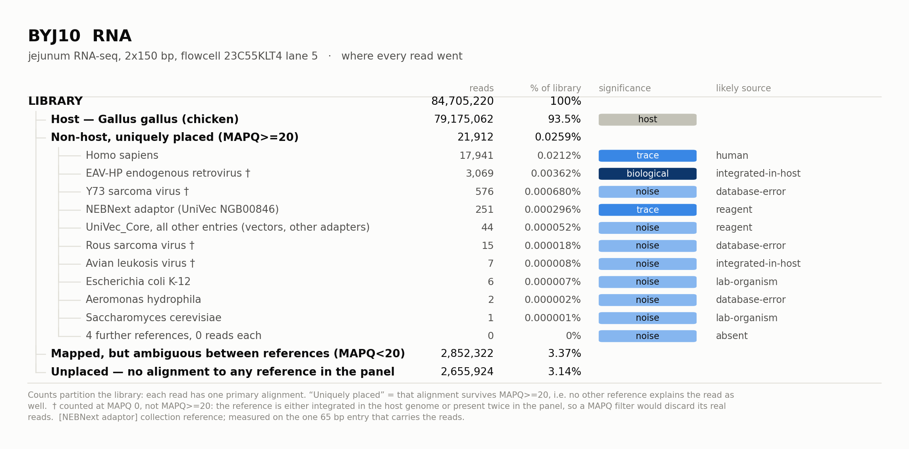
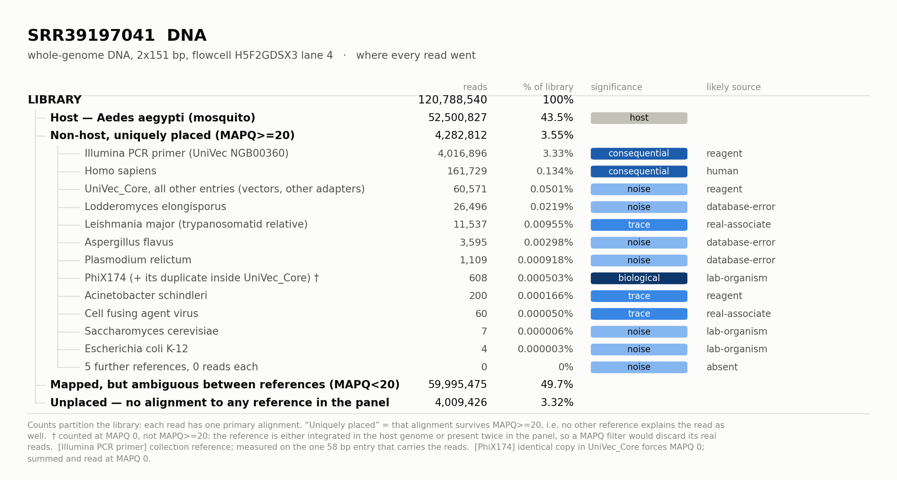

# Week 9 — Screening two readsets for non-target sequence

Detect, measure and attribute non-target (contaminating or unexpected) sequence
in one RNA-seq readset and one DNA WGS readset, and decide for each detection
how much it matters and where it most likely came from.

| | RNA-seq | DNA WGS |
|---|---|---|
| Sample | `BYJ10` | `SRR39197041` |
| Host | *Gallus gallus* (chicken), jejunum | *Aedes aegypti* (mosquito) |
| Library | paired-end RNA-seq, 2×150 bp | paired-end WGS, 2×151 bp |
| Reads | 42,352,610 pairs | 60,394,270 pairs |
| Flowcell / lane | `23C55KLT4` run 534 lane 5 | `H5F2GDSX3` lane 4 |
| Stated context | ARV-infected bird | field/colony mosquito, SRA |

Everything was run first on a **100,000-read-pair test subsample** of each
readset to validate the pipeline, then on the full readsets. Test outputs are
kept under `*/test/`, full outputs under `*/full/`.

---

## How to reproduce

```bash
scripts/00_fetch_kraken2_db.sh      # prebuilt Kraken2 PlusPF-16 index
scripts/00_make_conda_envs.sh       # kraken2 2.1.3 + bracken; genomad + checkv
scripts/00_fetch_host_refs.sh       # chicken + mosquito genomes and transcriptomes
scripts/00_fetch_virus_dbs.sh       # geNomad DB, CheckV DB, RefSeq viral proteins

qsub -v LEVEL=test scripts/01_sendsketch.sh          # screen A
qsub -v LEVEL=test scripts/02_kraken2_bracken.sh     # screen B
qsub               scripts/02b_kraken2_controls.sh   # co-sequenced controls
bash               scripts/03_fetch_candidates.sh    # candidate + decoy genomes
qsub -v LEVEL=test scripts/04_competitive_map.sh     # competitive mapping
qsub -v LEVEL=test scripts/04b_host_competition.sh   # the EVE / host-integration test
python3            scripts/05_score_detections.py --sample BYJ10_RNA --level test
qsub -v LEVEL=test,SAMPLE=BYJ10_RNA scripts/06_assemble_and_virus.sh

# then repeat with LEVEL=full, and finally:
python3 scripts/07_build_report.py          --level full   # wide per-method evidence table
python3 scripts/08_report_and_figures.py    --level full   # detection table + provenance trees
```

`04b` must run before `05`: the host-competition result is what lets `05` tell an
endogenous viral element apart from a cross-mapping artifact, and without it
EAV-HP is binned `noise` and Y73 sarcoma virus is binned `consequential` — both
wrong. `08` reads `metadata/attribution.tsv` and rewrites the detection table
inside this README between its two `<!-- generated -->` markers.

All jobs are PBS scripts for the ASC `asax` cluster. `scripts/env.sh` loads the
Lmod modules and is safe to source under `set -e`.

---

## Design: why these tools, in this order

The pipeline is deliberately built as **three independent lines of evidence**
that fail in different ways, followed by a **measurement** step and an
**attribution** step. No detection is reported on the strength of one method.

### Step 1 — `sendsketch.sh` (BBTools): database-free hypothesis generation

`sendsketch.sh` builds a MinHash sketch of the reads locally and sends only the
sketch to JGI's server, which compares it against the complete RefSeq and nt
sketch collections. That gives a genome-wide, **uncapped** answer in seconds
with no local database at all.

It is the right instrument for *"what might be in here?"* and the wrong
instrument for *"how much?"* — a sketch hit of four shared hashes looks
identical whether it came from a real organism at low abundance or from four
spurious reads. So every hit it raises is treated strictly as a hypothesis.

Both `refseq` and `nt` are queried, because they fail differently: RefSeq is
curated and has clean taxonomy but misses unusual taxa; nt is far broader but
is full of mislabelled entries. **A hit present in both is much stronger
evidence than a hit in either alone**, and that disagreement is used explicitly
in the detection table.

### Step 2 — Kraken2 + Bracken: exact k-mer classification, per read

Kraken2 classifies *every* read against an exact k-mer index, so unlike
sendsketch it produces countable per-taxon read numbers — the quantity the four
significance bins actually need.

* **Database: PlusPF-16GB** (bacteria, archaea, viral, plasmid, human,
  UniVec_Core, protozoa, fungi). Fungi and protozoa are included deliberately:
  reagent and lab-organism contaminants are frequently fungal, and a
  bacteria-only database would simply be blind to them.
* **`--confidence 0.1`.** At the default of 0 a read is assigned if *any* k-mer
  matches, which generates a long tail of single-k-mer false positives —
  exactly the "noise" bin we are trying to exclude. Requiring 10 % of a read's
  k-mers to support the call costs a little sensitivity, which is acceptable
  because sendsketch already covers the sensitive end.
* **`--report-minimizer-data`.** This is the single most useful
  anti-false-positive flag Kraken2 has. It reports the number of *distinct*
  minimizers supporting each taxon. A genuinely present genome is hit across
  many different minimizers; a spurious taxon is hit by a handful of minimizers
  over and over (one repeat, one conserved rRNA). Nothing in the plain report
  distinguishes these two cases.
* **Bracken** then redistributes reads that Kraken2 parked at genus/family
  (because the species has close relatives in the database) down to species
  level. **See the caveat below — in this dataset Bracken is actively
  misleading, and that is itself one of the findings.**

### Step 2b — control screens on the co-sequenced samples

This is what makes source attribution falsifiable rather than a plausibility
argument. The read headers reveal the batch structure:

| Group | Samples | Relationship |
|---|---|---|
| A | **BYJ10**, AYJ9 | same flowcell `23C55KLT4`, **same lane 5** |
| B | SYJ7, SYJ10 | **different** flowcell `237VF5LT4` lane 7 |
| C | **SRR39197041**, SRR39197043 | same flowcell `H5F2GDSX3`, **same lane 4** |

Those groupings separate source categories that read fraction, depth and
breadth cannot separate on their own:

* **Bleed-through (index hopping)** can only come from a library on the *same
  lane*. If a taxon is abundant in AYJ9 and present in BYJ10 at ~0.1–1 % of
  AYJ9's level, index hopping is the leading explanation. If the taxon is
  absent from AYJ9, index hopping is *ruled out*.
* **Reagent contamination** tracks the kit, not the flowcell — it should appear
  across group A *and* group B.
* **A real biological associate** tracks the sample, not the batch.

Each source call therefore makes a prediction that the controls confirm or
refute.

### Step 3 — competitive mapping (minimap2 + samtools): the measurement

**Why minimap2 rather than bowtie2.** The combined reference is ~4 Gb (host +
human decoy + every candidate). minimap2 indexes that in minutes where
`bowtie2-build` takes many hours, and the ASC bowtie2 module is 2.2.9 (2016).
The `-ax sr` preset is a short-read mode as accurate as bowtie2 for 150 bp
pairs, and it tolerates **divergent** alignment better — which matters a great
deal here, because a candidate reference is usually a database *relative* of
the organism actually present, not the exact strain. bowtie2 end-to-end would
drop those reads and we would under-call real detections.

**Why one combined reference rather than one BAM per candidate.** Mapping to a
candidate in isolation is the commonest way to manufacture a false
contamination result: conserved rRNA, ribosomal-protein and transposon reads
from the host and from everything else have nowhere else to go, so they pile
onto the candidate's conserved loci and produce impressive-looking depth over a
few narrow windows. In a competitive reference every read goes to its single
best match, so a read is credited to a candidate only when that candidate
explains it better than the host, the human decoy and every lab-organism decoy.

**The decoy panel** (human, PhiX174, *E. coli* K-12, *S. cerevisiae*,
UniVec_Core) exists precisely to absorb reads that would otherwise be forced
onto a candidate, and it maps one-to-one onto the source categories we have to
adjudicate between (human / lab organism / reagent-vector).

**Why MAPQ ≥ 20.** MAPQ encodes how much better the best alignment is than the
second best. Requiring ≥ 20 discards reads that map about equally well to the
candidate and to something else — precisely the ambiguous reads that inflate
breadth. This filter is what makes breadth mean *"sequence unique to this
organism is present"*.

**`-I 12G`** forces a single-part minimap2 index. With a multi-part index
minimap2 maps against each part independently and computes MAPQ within a part,
which silently destroys the competitive comparison the whole design rests on.

### Step 4 — scoring (`05_score_detections.py`)

Per candidate, from `samtools coverage` over the whole reference:

* **read fraction** = reads at MAPQ ≥ 20 ÷ total reads in the library
* **depth** = mean per-base depth across the entire reference
* **breadth** = fraction of reference bases covered at ≥ 1×

plus three statistics that exist only to catch false positives:

* **`mapq_survival`** = reads at MAPQ ≥ 20 ÷ reads at MAPQ ≥ 0. A real
  organism's reads are unique to it and keep a high MAPQ; a cross-mapping
  artifact collapses when ambiguous reads are removed.
* **`gini`** = Gini coefficient of per-base depth. Breadth and mean depth cannot
  distinguish an even genome-wide 0.5× from a 25× spike over 2 % of the genome,
  yet those mean opposite things. A genuine organism gives low-to-moderate
  Gini; a conserved-locus or database-error artifact gives Gini near 1.
* **`top1pct_share`** = share of aligned bases in the most-covered 1 % of the
  reference — a blunter, more explainable version of the same idea.

### Step 5 — RNA-virus arm (`06_assemble_and_virus.sh`)

Everything above compares reads to references that already exist. A divergent
RNA virus produces reads that sendsketch and Kraken2 simply leave unclassified
— the commonest way a real viral finding is missed. Assembly reconstructs the
genome from the data itself.

* **Host depletion first**, against the host **genome and transcriptome**. With
  the `-ax sr` short-read preset a read spanning an mRNA splice junction aligns
  poorly to the genome and would survive depletion as a false "non-host" read;
  the transcriptome catches exactly those. Only pairs where *neither* mate maps
  are carried forward, which is the conservative choice.
* **MEGAHIT and rnaSPAdes, both.** They fail in different places and after
  depletion the read set is small enough that running both is cheap. MEGAHIT
  copes with the enormous dynamic range of a contamination screen; rnaSPAdes
  reconstructs full-length RNA virus genomes markedly better. **A contig
  recovered independently by both is much stronger evidence than one recovered
  by either alone.**
* **geNomad** scores contigs as chromosome / plasmid / virus from marker-gene
  content rather than nucleotide similarity, so it can flag a virus with no
  close database relative — and it reports host-vs-viral gene content along a
  contig, which is direct evidence for calling something an *integrated
  element* rather than a free virus.
* **CheckV** estimates viral-contig completeness, which is exactly what
  separates "a viral fragment is present" (trace) from "a near-complete viral
  genome is present" (biological). It also flags host sequence *within* a
  contig — a second, independent read on the same EVE question.
* **DIAMOND blastx** against RefSeq viral proteins is independent of geNomad's
  marker set; protein similarity survives far greater nucleotide divergence, so
  it is the most sensitive way to name a divergent virus.

---

## The four significance bins

Thresholds are applied in this order, so a hit can never be promoted on the
strength of numbers the credibility checks have already discredited.

| Bin | Rule | Meaning |
|---|---|---|
| **noise** | < 50 unique reads, **or** breadth < 0.5 %, **or** `mapq_survival` < 0.25, **or** (Gini > 0.95 and breadth < 5 %) | Not credible. Consistent with cross-mapping or a database artifact. |
| **trace** | passes the above, but read fraction < 0.1 % **and** depth < 1× **and** breadth < 10 % | Real, but there is not enough of it to change any downstream result. |
| **consequential** | read fraction ≥ 0.1 % **or** depth ≥ 1× **or** breadth ≥ 10 % | Enough to shift expression estimates, pull mis-assembled contigs into an assembly, or seed false variant calls. |
| **biological** | breadth ≥ 50 % at depth ≥ 1×, **or** CheckV completeness ≥ 90 % | A near-complete genome is present; this is a finding about the sample, not a QC footnote. |

## Source categories and the evidence that distinguishes them

| Source | Evidence that supports it over the alternatives |
|---|---|
| **real associate / cobiont** | Broad, even coverage (low Gini) at a depth consistent with a real population; tracks the *sample* not the batch; absent or different in co-lane controls; ecologically coherent with the host. |
| **integrated in host genome (EVE)** | Reads also align to the host assembly; depth tracks host depth at a fixed ratio; contigs carry viral sequence flanked by host sequence; present at the same level in *every* sample of that host regardless of flowcell. |
| **reagent** | Taxon is a known kit organism; appears across *different* flowcells and library batches; abundance inversely related to input biomass; low, patchy breadth. |
| **bleed-through (index hopping)** | Taxon is the *dominant* organism of another library on the **same lane**, present here at ~0.1–1 % of that level. Excluded if the co-lane sample lacks it or has it at equal level. |
| **library chimera** | Reads are internally chimeric — part host, part other — with breakpoints at ligation junctions; discordant pairs; coverage islands at the junction only. |
| **human** | Clean primate phylogeny with *Homo sapiens* on top and unique (non-shared) matches; even genome-wide coverage distinguishes a bloodmeal or real contamination from conserved-vertebrate mis-assignment. |
| **lab organism** | PhiX174, *E. coli* K-12, *S. cerevisiae*, cloning vectors — present in the decoy panel so they claim their own reads instead of contaminating a candidate's count. |
| **database error** | Reads pile onto a *narrow region* of the candidate reference (high Gini, low breadth) and that region is itself a contaminant insert in the reference; `mapq_survival` collapses once the true source is in the competitive reference. |

---

## Results — where every read came from





Each tree partitions the whole library: every read has exactly one primary
alignment, so the four branches — host, non-host, ambiguous, unplaced — add up
to the read count at the top. "Uniquely placed" means that alignment survives
MAPQ ≥ 20, i.e. no other reference in the panel explains the read as well.

Both figures and the table below are regenerated by

```bash
python3 scripts/08_report_and_figures.py --level full
```

which reads the measurements from `results/` and the two judgement columns
(final bin, likely source) from `metadata/attribution.tsv`, where every call is
tied to a named piece of evidence.

### What the two libraries actually contain

**`BYJ10` chicken jejunum RNA-seq.** No exogenous pathogen is present; what
is there is the chicken's own endogenous retroviral background, plus a human
and an adapter trace. The only `biological` detection is **EAV-HP**, the
endogenous avian retrovirus, at 98.8 % breadth and 106× — and the
host-competition test shows 79 % of its reads align at least as well to the
chicken genome, so it is part of the chicken, not an infection. The notable
result is a **negative**: the sample is annotated "ARV-infected", and at full
depth there are **zero avian orthoreovirus reads** across all ten segments in
the competitive mapping, and zero Kraken2 reads in this library and in all
three co-sequenced controls.

**`SRR39197041` *Aedes aegypti* WGS.** The library is 3.3 % unremoved Illumina
PCR primer, carries 0.13 % human DNA, and contains a complete PhiX174 genome.
*Wolbachia* and Phasi Charoen-like virus — the two things one would most expect
in a field *Aedes* — are both absent. A trypanosomatid related to *Leishmania*
is present at low, genuinely genome-wide coverage, and cell fusing agent virus
at the detection floor.

### Where the automatic bin is wrong

Three detections are mis-binned by the rules in
`05_score_detections.py`, and all three failures are instructive rather than
accidental. They are corrected explicitly in
`scripts/08_report_and_figures.py`, never silently.

| What went wrong | Why | Effect |
|---|---|---|
| **A reference entered the panel twice.** `UniVec_Core` contains the complete phi-X174 genome (`gnl\|uv\|J02482.1`, 5,375/5,375 identical bases) as well as the `PhiX174` decoy. | Every PhiX read has two perfect placements, so MAPQ is 0 and the MAPQ ≥ 20 filter deletes all of them. Kraken2 fails identically — its database also holds phi-X174 twice, so the k-mer LCA is the root of the taxonomy. | PhiX called `noise — fewer than 50 mapped reads`; it is a **complete genome at ~14×**. See [the write-up](reports/writeup_phix.md). |
| **A collection reference was measured as if it were a genome.** Breadth was computed over all 688 kb of `UniVec_Core`. | An adapter present at a million-fold depth still covers only 0.23 % of the collection, which trips the 0.5 % breadth floor. | 4,016,896 adapter reads — **3.33 % of the library**, at 100 % breadth on the one 58 bp entry they came from — called `noise`. |
| **The breadth floor is reference-length dependent.** 0.5 % of the 3.1 Gb human genome is 15 Mb; 18,000 reads cannot cover that however real they are. | The floor is unreachable for a large reference at low abundance, so it rejects exactly the detections it was meant to size. | Human called `noise` in both libraries. |

The length-free replacement for the breadth floor is in the table as
**`evenness`**:

```
evenness = observed breadth / (1 − e^−depth)
```

The denominator is the breadth a randomly-placed library of that depth would
give (Lander–Waterman). Near 1 means the reads are spread over the reference
the way a real population's are; near 0 means they are piled on a few conserved
or repetitive loci, which is what cross-mapping looks like. It separates the two
cases a fixed breadth threshold conflates: human in the mosquito WGS scores
0.65 (genome-wide, real), while *Lodderomyces* scores 0.002 (26,496 reads inside
0.02 % of the genome, an rDNA artifact) — and both have breadth under 0.5 %.

The single pre-flight check the design was missing: **an all-vs-all alignment of
the reference panel against itself**, which takes minutes and would have caught
`UniVec_Core` ⊃ `PhiX174` before any read was mapped.

---

## Detection table

<!-- BEGIN generated: detection table -->
`bin` is the final call; where the automatic rule in `05_score_detections.py` disagreed, its verdict is shown as `auto: <bin>` and the reason is in the evidence column.

`evenness` is observed breadth divided by the breadth a randomly placed library of that depth would give (`1 - e^-depth`). Near 1 means the reads are spread across the reference like a real population's; near 0 means they are piled on a few loci.

† measured at MAPQ 0 rather than MAPQ>=20, because the sequence is integrated in the host genome or present twice in the reference panel — in both cases a MAPQ filter throws away its real reads. MAPQ survival is left blank for those rows, where it would be 1.0 by construction.

## BYJ10_RNA — Gallus gallus (chicken)

*jejunum RNA-seq, 2x150 bp, flowcell 23C55KLT4 lane 5; 84,705,220 reads; host claims 79,175,062 (93.5%) at MAPQ>=20.*

| organism | bin | likely source | reads | read fraction | depth | breadth | evenness | MAPQ surv. | why |
|---|---|---|---:|---:|---:|---:|---:|---:|---|
| EAV-HP endogenous retrovirus † | **biological** | integrated-in-host | 3,069 | 0.00362% | 106 | 98.8% | 0.99 | - | 98.8% of the 4,302 bp genome covered at 105.7x; 79.1% of its reads align at least as well to the chicken genome+transcriptome (04b); alpharetroviral signal is equal in all four chicken libraries across two flowcells, so it tracks the host species, not the batch |
| Homo sapiens | **trace**<br>`auto: noise` | human | 17,941 | 0.0212% | 0.000699 | 0.00446% | 0.064 | 0.12 | 17,941 reads (0.021%) survive MAPQ>=20 and 69% of them are not host-competing; Kraken2 puts human at 0.08-0.10% in all six libraries in this project across two host species, two labs and three flowcells -- a constant floor, not a property of this sample |
| NEBNext adaptor (UniVec NGB00846) | **trace**<br>`auto: noise` | reagent | 251 | 0.000296% | 125 | 100% | 1 | 0.0023 | 295 reads at MAPQ>=20, of which 251 sit on a single 65 bp NEBNext adaptor at 100% breadth; adapter read-through, not an organism |
| Y73 sarcoma virus † | **noise** | database-error | 576 | 0.000680% | 16.4 | 44.2% | 0.44 | - | 98.3% of its reads prefer the host once the chicken transcriptome is in the competition (04b); coverage is confined to the 34% of the reference that is the transduced host v-yes/YES1 gene, so these are chicken transcripts, not virus |
| UniVec_Core, all other entries (vectors, other adapters) | **noise** | reagent | 44 | 0.000052% | - | - | - | - | the remainder of the UniVec_Core collection once the one entry that carries the bulk of the reads is counted separately; spread thinly over ~3,000 unrelated vector and adapter sequences |
| Rous sarcoma virus † | **noise** | database-error | 15 | 0.000018% | 0.227 | 9.60% | 0.47 | - | 0 reads at MAPQ>=20; 92% of the 77 reads it attracts are host-competing (transduced v-src) |
| Avian leukosis virus † | **noise** | integrated-in-host | 7 | 0.000008% | 0.0498 | 2.73% | 0.56 | - | 0 reads at MAPQ>=20; the 18 reads it attracts are 78% host-competing -- endogenous ALV-like background, the same signal EAV-HP captures |
| Escherichia coli K-12 | **noise** | lab-organism | 6 | 0.000007% | 0.000176 | 0.0124% | 0.71 | 0.023 | 6 reads at MAPQ>=20; decoy working as intended |
| Aeromonas hydrophila | **noise** | database-error | 2 | 0.000002% | 2.59e-05 | 0.00133% | 0.51 | 0.0046 | 2 reads at MAPQ>=20 out of 433; survival 0.005 |
| Saccharomyces cerevisiae | **noise** | lab-organism | 1 | 0.000001% | 1.15e-05 | 0.00115% | 1 | 0.0086 | 1 read at MAPQ>=20; decoy working as intended |
| Avian orthoreovirus | **noise** | absent | 0 | 0% | 0 | 0% | - | - | 0 reads at any MAPQ over all 10 segments, and 0 Kraken2 reads in all four chicken libraries -- despite the stated "ARV-infected" sample context |
| Chlamydia abortus | **noise** | database-error | 0 | 0% | 0 | 0% | - | 0 | 1 read at MAPQ 0, 0 survive |
| Chlamydia psittaci | **noise** | database-error | 0 | 0% | 0 | 0% | - | 0 | 3 reads at MAPQ 0, 0 survive |
| PhiX174 | **noise** | absent | 0 | 0% | 0 | 0% | - | - | 0 reads at any MAPQ -- this RNA run carried no PhiX spike-in, in contrast to the DNA library |

## SRR39197041_DNA — Aedes aegypti (mosquito)

*whole-genome DNA, 2x151 bp, flowcell H5F2GDSX3 lane 4; 120,788,540 reads; host claims 52,500,827 (43.5%) at MAPQ>=20.*

| organism | bin | likely source | reads | read fraction | depth | breadth | evenness | MAPQ surv. | why |
|---|---|---|---:|---:|---:|---:|---:|---:|---|
| PhiX174 (+ its duplicate inside UniVec_Core) † | **biological**<br>`auto: noise` | lab-organism | 608 | 0.000503% | 14.5 | 100% | 1 | - | Complete 5,386 bp genome at 100% breadth and ~14x once its duplicate copy inside UniVec_Core is counted back in; reassembled end-to-end with direct terminal repeats by MEGAHIT and rnaSPAdes independently and scored 100% complete by CheckV; missed entirely by Kraken2 (235/394 reads unclassified, 159 parked at root) and zeroed by competitive mapping, both for the same reason -- the sequence is in the database twice |
| Illumina PCR primer (UniVec NGB00360) | **consequential**<br>`auto: noise` | reagent | 4,016,896 | 3.33% | 999,846 | 100% | 1 | 0.58 | 4,016,896 reads, 3.33% of the library, on one 58 bp Illumina PCR primer entry at 100% breadth and ~1e6 x depth; the library was not adapter-trimmed before submission |
| Homo sapiens | **consequential**<br>`auto: noise` | human | 161,729 | 0.134% | 0.00734 | 0.473% | 0.65 | 0.62 | 161,729 reads (0.134%); observed breadth 0.473% is 65% of the Poisson expectation for 0.0073x, so the reads are spread genome-wide rather than piled on conserved loci; the same 0.08-0.10% floor appears in every library in this project, so handler/reagent -- not a bloodmeal and not index hopping |
| Leishmania major (trypanosomatid relative) | **trace**<br>`auto: noise` | real-associate | 11,537 | 0.00955% | 0.0391 | 2.13% | 0.56 | 0.58 | 11,537 reads survive MAPQ>=20 and are spread over 35 of the 36 chromosomes at a near-identical 2-3% breadth and 0.04-0.07x depth each -- the signature of a DIVERGENT relative, where only the conserved few per cent of each chromosome aligns, not of a spike artifact; Trypanosomatida sits at the same level in the co-lane control (4,073 vs 4,295), which is what a cobiont shared by the mosquito population looks like. The organism present is a trypanosomatid, most plausibly a monoxenous mosquito-infecting genus; Leishmania major is the database stand-in, not the identification |
| Acinetobacter schindleri | **trace**<br>`auto: noise` | reagent | 200 | 0.000166% | 0.00696 | 0.374% | 0.54 | 0.75 | 200 reads with 75% MAPQ survival and breadth at 54% of Poisson expectation -- credible but minute; Acinetobacter is a canonical extraction-kit organism |
| Cell fusing agent virus | **trace** | real-associate | 60 | 0.000050% | 0.572 | 6.52% | 0.15 | 0.91 | 60 reads, 91% of which survive MAPQ>=20, over 6.5% of the genome at 0.57x; CFAV is the canonical insect-specific flavivirus of Aedes aegypti, present both as free virus and as EVEs in the host genome |
| UniVec_Core, all other entries (vectors, other adapters) | **noise** | reagent | 60,571 | 0.0501% | - | - | - | - | the remainder of the UniVec_Core collection once the one entry that carries the bulk of the reads is counted separately; spread thinly over ~3,000 unrelated vector and adapter sequences |
| Lodderomyces elongisporus | **noise** | database-error | 26,496 | 0.0219% | 0.1 | 0.0219% | 0.0023 | 0.037 | 714,810 reads at MAPQ 0 collapse to 26,496 at MAPQ>=20, all inside 0.02% of the genome (2/1000 of Poisson expectation) -- rDNA and repeat cross-mapping |
| Aspergillus flavus | **noise** | database-error | 3,595 | 0.00298% | 0.00411 | 0.00660% | 0.016 | 0.17 | survival 0.17, breadth at 1.6% of expectation |
| Plasmodium relictum | **noise** | database-error | 1,109 | 0.000918% | 0.00403 | 0.0328% | 0.082 | 0.038 | survival 0.04 and breadth at 8% of expectation; Kraken2 reports it at the same level in the co-lane control (10,316 vs 8,291) |
| Saccharomyces cerevisiae | **noise** | lab-organism | 7 | 0.000006% | 3.46e-05 | 0.00197% | 0.57 | 0.01 | 7 reads at MAPQ>=20 out of 702; decoy working as intended |
| Escherichia coli K-12 | **noise** | lab-organism | 4 | 0.000003% | 8.88e-05 | 0.00444% | 0.5 | 0.57 | 4 reads at MAPQ>=20; decoy working as intended |
| Achromobacter xylosoxidans | **noise** | absent | 0 | 0% | 0 | 0% | - | 0 | 4 reads at MAPQ 0, 0 survive |
| Lactobacillus phage Semele | **noise** | absent | 0 | 0% | 0 | 0% | - | - | 0 reads at any MAPQ |
| Phasi Charoen-like virus | **noise** | absent | 0 | 0% | 0 | 0% | - | - | 0 reads on all three segments -- the commonest Aedes aegypti insect-specific virus is not present |
| Pseudomonas aeruginosa | **noise** | absent | 0 | 0% | 0 | 0% | - | 0 | 5 reads at MAPQ 0, 0 survive |
| Wolbachia pipientis | **noise** | absent | 0 | 0% | 0 | 0% | - | 0 | 0 reads at MAPQ>=20 and 4 at MAPQ 0; Kraken2 sees 0 here and 3 in the control -- this mosquito line is Wolbachia-free |
<!-- END generated: detection table -->

---

## The most interesting detection

[**reports/writeup_phix.md**](reports/writeup_phix.md) — a complete, circular,
100 %-complete *Microviridae* genome, recovered independently by MEGAHIT and
rnaSPAdes from the mosquito WGS library, that four of the five detection methods
missed entirely and the fifth mis-named. It is PhiX174 at 99.3 % identity: the
Illumina sequencing control. The one-pager works through why every
database-dependent method was blind to it, why assembly was not, and why read
fraction (0.0005 %) is the weakest of the three statistics.

---

## Repository layout

```
data/                 raw readsets (not tracked) + 100k-pair test subsamples
metadata/
  datasets.txt        provenance of both readsets
  candidates.tsv      reference panel for competitive mapping (name/role/source/id/restrict)
  attribution.tsv     final bin + likely source per detection, each tied to named evidence
references/
  host/               chicken + mosquito genomes and transcriptomes
  candidates/         candidate and decoy genomes
  combined/           per-readset competitive references and cached minimap2 indexes
  db/                 Kraken2 PlusPF-16, geNomad, CheckV, RefSeq viral proteins
scripts/              numbered pipeline stages, each with its rationale in the header
results/
  sendsketch/{test,full}/
  kraken2/{test,full,controls}/
  coverage/{test,full}/     BAMs, samtools coverage, per-base depth, detection tables
  host_competition/{test,full}/  the EVE test: is this sequence integrated in the host?
  assembly/{test,full}/     contigs, geNomad, CheckV, DIAMOND
reports/
  detection_table.full.{tsv,md}  the detection table (also injected into this README)
  figures/            read-provenance trees, one PNG per readset
  writeup_phix.md     one-page write-up of the most interesting detection
logs/                 PBS job logs
```
